# Flujos implementados y capturas

Las capturas están en `docs/capturas/`.

| Flujo | Descripción | Captura |
|---|---|---|
| Inicio de sesión | Validación de correo y contraseña, error del servidor y persistencia de la sesión | `01-login.png` |
| Inicio | Contadores por estado, actividades vencidas, próximas evaluaciones y tareas de la semana | `02-inicio.png` |
| Agenda | Actividades agrupadas por día con estado; filtro "Por hacer / Todas" | `03-agenda.png` |
| Tareas | Lista con filtros por tipo y estado, prioridad y avance; botón para crear una actividad | `04-tareas.png` |
| Detalle de tarea | Cambio de estado (con confirmación al completar) y marcado de subtareas con barra de avance | `05-detalle-tarea.png` |
| Asignaturas | Lista con cantidad de actividades por hacer y detalle con sus tareas y evaluaciones; botón para crear una asignatura | `06-asignaturas.png` |
| Crear asignatura | Formulario con nombre, profesor, período y color | `09-crear-asignatura.png` |
| Crear actividad | Formulario con título, descripción, fecha y hora límite, asignatura, tipo y prioridad | `10-crear-actividad.png` |
| Persistencia compartida | Cambio de estado realizado desde el móvil y reflejado en la aplicación web | `07-web-antes.png`, `07-movil-durante.png`, `07-web-despues.png` |
| Error de autenticación | Mensaje mostrado al intentar iniciar sesión con credenciales incorrectas | `08-error-login.png` |

## Estados de interfaz
- **Carga:** `LoadingView` al entrar a cada pantalla; botones deshabilitados mientras se guarda.
- **Error:** `ErrorView` con mensaje del backend o de red y botón "Reintentar".
- **Vacío:** `EmptyState` con texto específico por pantalla.
- **Confirmación:** `Toast` tras guardar y `Alert` antes de marcar como completada.

## Persistencia compartida con la web
Un cambio de estado o de subtareas hecho en el móvil se guarda con `PUT /tareas/:id`
en PostgreSQL, el backend registra el evento en el historial (MongoDB) y el cambio se ve al recargar la aplicación web.
Las siguientes capturas evidencian la consistencia de los datos entre ambos clientes:

1. `07-web-antes.png`: estado de la tarea antes de realizar el cambio.
2. `07-movil-durante.png`: modificación del estado desde la aplicación móvil.
3. `07-web-despues.png`: estado actualizado de la misma tarea después de recargar la aplicación web.

## Capturas

| Inicio de sesión | Inicio | Agenda |
|---|---|---|
| 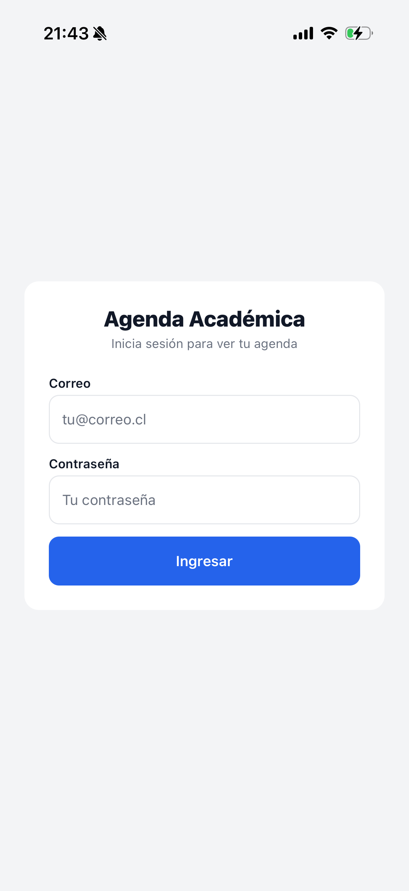 | 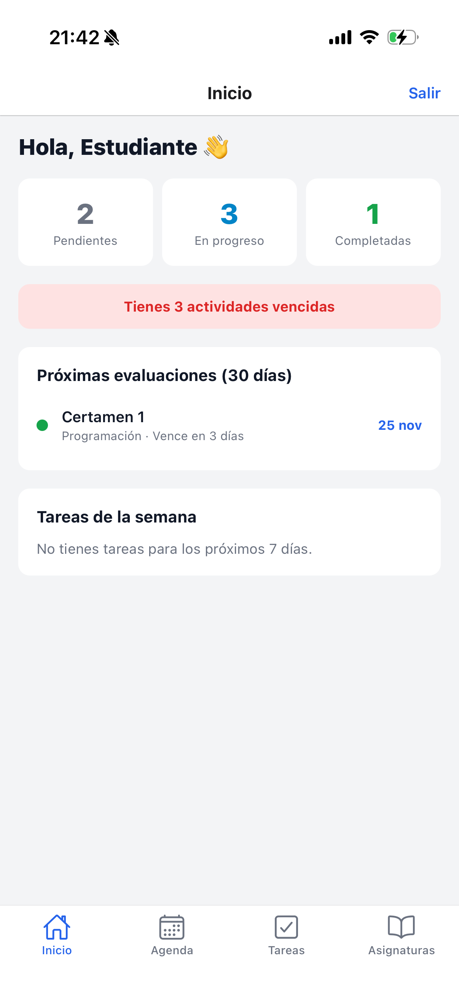 | 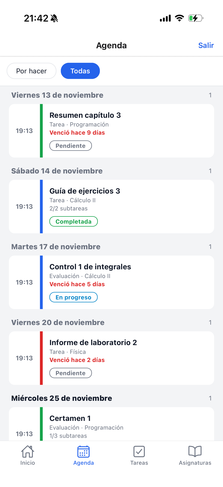 |

| Tareas | Detalle de tarea | Asignaturas |
|---|---|---|
| 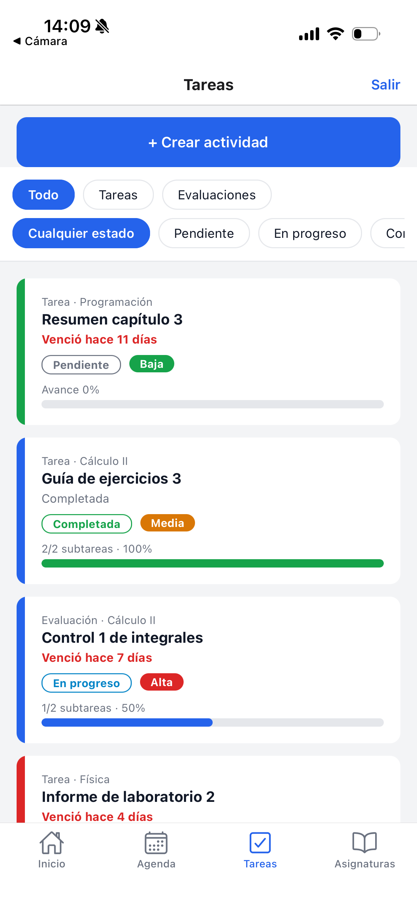 | 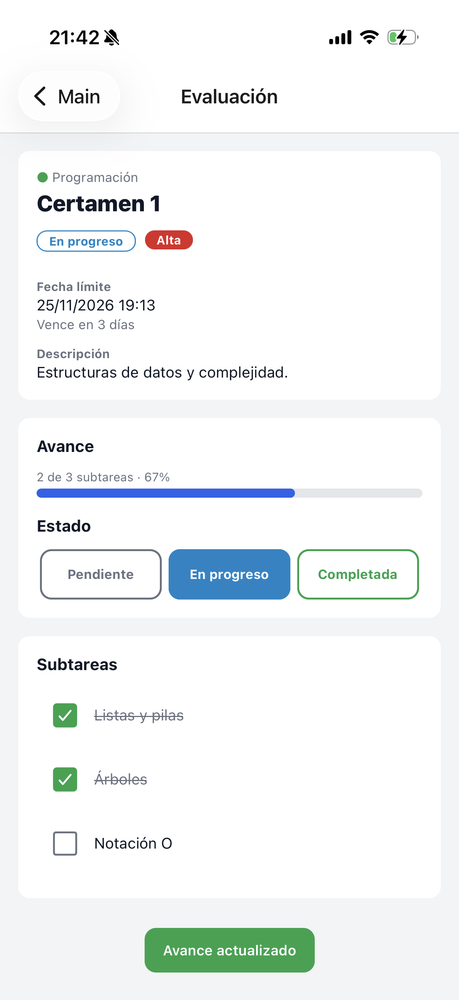 | 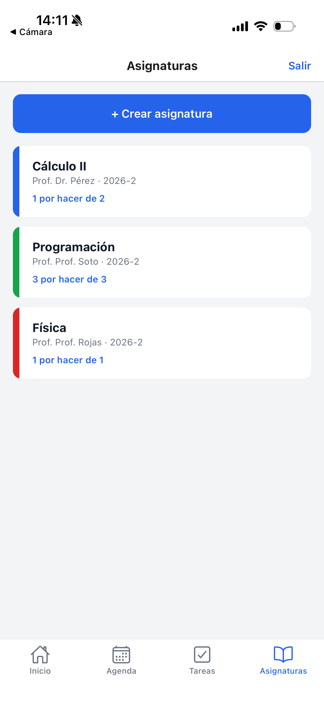 |

### Creación desde el móvil

| Crear asignatura | Crear actividad |
|---|---|
| 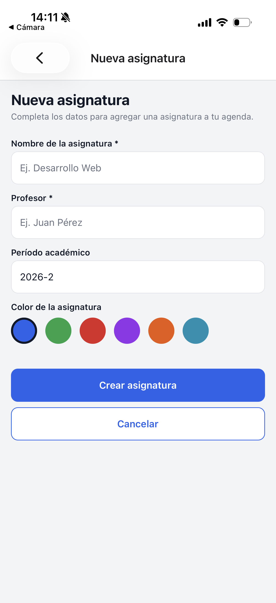 | 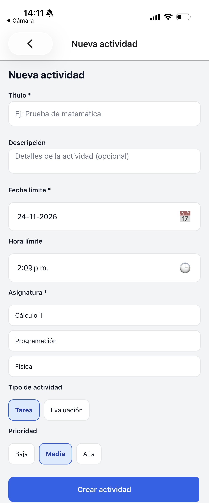 |

### Persistencia compartida

| Estado anterior en web | Cambio desde móvil |
|---|---|
| 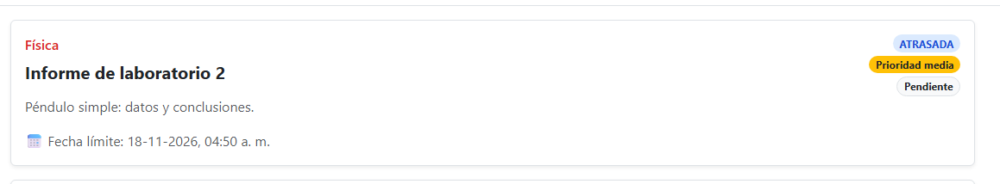 | 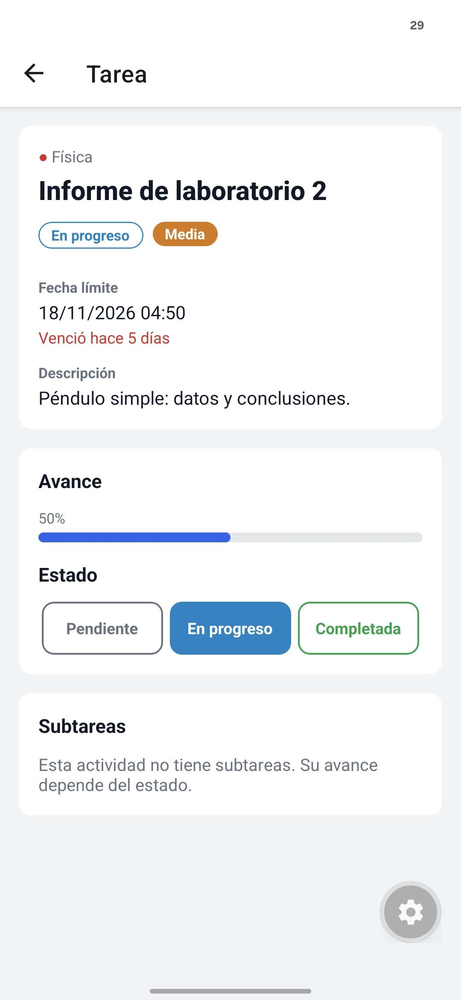 |

| Estado actualizado en web | Error de inicio de sesión |
|---|---|
| 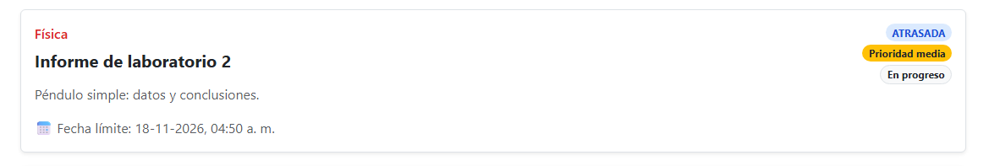 | 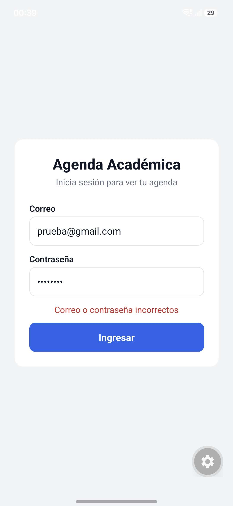 |
